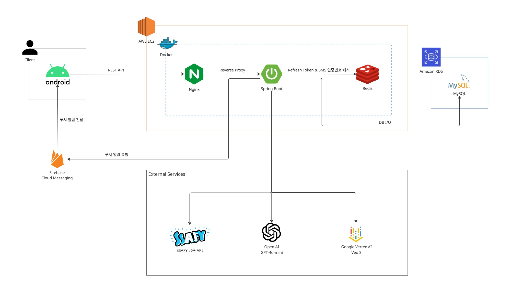

<div align="center">


# Tiggle Backend API

### 티끌 같은 잔돈을 모아 태산 같은 기부로, 캠퍼스 참여형 핀테크 플랫폼
매주 1,000원 미만의 자투리 잔돈과 더치페이 정산 잔돈을 모아 대학 단위의 선한 영향력을 만드는 백엔드 코어 시스템

<br/>


<br/>


</div>

## 개요

Tiggle은 **티끌 같은 잔돈을 모아 태산 같은 기부로**라는 슬로건 아래, 개인이 일상에서 남기는 소액 잔돈을 대학 구성원들이 함께 모아 거대한 사회적 가치로 전환하는 캠퍼스 참여형 핀테크 서비스입니다.

혼자서는 고작 몇 백 원, 몇 천 원에 불과할지라도 대학 단위로 모이면 의미 있는 큰 기부금이 될 수 있다는 집단적 효능감에 주목하여, 대학생의 일상 소비 패턴에 맞춘 두 가지 모금 파이프라인을 제공합니다.

1. **매주 1,000원 미만의 자투리 잔돈 자동 이체**: 주간 스케줄러를 통해 사용자 주계좌에 남은 1,000원 미만의 자투리 금액을 저금통으로 자동 적립
2. **더치페이 후 남는 애매한 잔돈 기부**: 모임 정산 과정에서 발생하는 1/N 자투리 잔돈을 버리지 않고 대학 모금 계좌로 자연스럽게 결집

## 시스템 아키텍처



### 아키텍처 구성 요소

1. **클라이언트 (Android)**
   - Nginx 리버스 프록시를 통해 REST API 통신 수행
   - Firebase Cloud Messaging(FCM)을 통한 더치페이 정산 및 주요 이벤트 푸시 알림 수신

2. **AWS EC2 (Docker 컨테이너 환경)**
   - **Nginx**: 클라이언트의 인바운드 트래픽을 수신하여 내부 Spring Boot 컨테이너로 안전하게 라우팅하는 리버스 프록시
   - **Spring Boot (코어 API 서버)**:
     - 회원, 계좌, 저금통, 기부, 더치페이 핵심 비즈니스 로직 및 트랜잭션 처리
     - Redis 인메모리 저장소를 활용한 Refresh Token 및 SMS 본인 인증번호 캐시 관리
     - 비동기 도메인 이벤트를 통한 FCM 푸시 알림 발송 요청
     - Amazon RDS(MySQL)와의 영속성 DB I/O 처리
   - **Redis**: 토큰 만료 관리 및 SMS 인증번호 캐싱

3. **데이터베이스 및 외부 연동 서비스**
   - **Amazon RDS (MySQL)**: 사용자, 계좌 정보, 거래 내역, 더치페이 정산 데이터 영속화
   - **SSAFY 금융 API**: 서비스 제공을 위한 핵심 금융 API 전반 연동
   - **OpenAI & Google Vertex AI**: 경제 뉴스 크롤링 기반 대본 요약 및 AI 숏폼 영상 생성 파이프라인

## 핵심 백엔드 기능 및 기술 구현

### 1. 금융망 오픈 API 연동 및 이체 정합성 파이프라인
외부 금융망과의 통신 과정에서 네트워크 단절이나 외부 장애가 발생하더라도 데이터 불일치가 일어나지 않도록 리액티브 파이프라인을 구축했습니다.

- **조회-검증-이체-기록 순차 체인**: 계좌 조회 → 잔액 검증(WebClient) → 계좌 이체 실행(WebClient) → 최종 거래 내역 저장(DB Save) 단계로 이어지는 Mono 체인을 구성했습니다.
- **내부 DB 롤백(미기록)을 통한 정합성 유지**: 외부 금융 API 호출 중 하나라도 실패할 경우 트랜잭션 롤백 및 내부 데이터베이스 기록을 방지하여 금융 거래의 무결성을 보장합니다.

```java
// DonationServiceImpl.java
return financialApiService.inquireDemandDepositAccountBalance(userKey, accNo)
    .flatMap(balResponse -> {
        if (!isBalanceEnough(balResponse, request.getAmount())) {
            return Mono.error(DonationException.insufficientBalance());
        }
        return financialApiService.updateDemandDepositAccountTransfer(
            userKey, depositAccountNo, depositSummary, amountStr, withdrawalAccountNo, withdrawalSummary
        );
    })
    .then(Mono.fromCallable(() -> donationHistoryRepository.save(donationHistory)));
```

### 2. 주간 다단계 배치 스케줄러
매주 월요일 새벽, 3단계의 배치 스케줄러가 순차적으로 실행되어 안전하게 자금을 집계하고 이체합니다.

1. **WeeklyAutoSavingScheduler (매주 월요일 01:00 KST)**
   - 사용자가 자동 저축을 설정해 둔 저금통을 조회합니다.
   - 사용자 주계좌의 최근 거래 내역과 잔액을 조회하여 1,000원 미만의 자투리 잔돈을 계산한 뒤 저금통 계좌로 자동 이체합니다.
   - 주차별 고유 거래 식별값을 기록하여, 스케줄러가 재실행되더라도 같은 주에 돈이 중복 이체되지 않도록 멱등성을 보장합니다.
2. **WeeklyUniversityDonationScheduler (매주 월요일 02:00 KST)**
   - 목표 금액을 달성하고 자동 기부를 설정한 저금통을 선별합니다.
   - **가상계좌 집금 원리 기반 대량 이체 락 방지**: 단일 학교 계좌로 수많은 학생의 개별 송금이 집중될 경우 발생할 수 있는 금융망 계좌 락(Lock) 및 처리 지연 위험을 방지하기 위해, 학생 저금통에서 개별 출금한 금액을 내부 집계한 뒤 대학·테마별로 묶어 단 1회 일괄 송금하는 집금 구조를 구축했습니다.
   - **원자적 선점을 통한 중복 방지**: 이체 직전 대상 상태를 원자적 선점 처리하여 다중 스케줄러 환경에서도 동일한 기부 건이 중복 실행되지 않도록 격리했습니다.
   - **전 과정 감사 로그 기록**: 출금 선점, 개별 출금, 최종 합산 송금 및 예외 발생 등 전 정산 과정을 타임스탬프 기반 파일 감사 로그로 상세히 기록하여 금융 거래의 감사 추적성을 확보했습니다.
3. **DonationScheduler (매주 월요일 06:00 KST)**
   - 주간 동안 학교 계좌에 모인 기부금을 최종 기부 단체 법인 계좌로 일괄 이체하고, Redis 및 DB의 랭킹 캐시를 갱신합니다.

### 3. 도메인 이벤트 기반 비동기 정산 및 알림
더치페이 요청 및 상태 변경 시, 핵심 비즈니스 로직과 외부 알림 발송 책임을 분리하기 위해 Spring Event를 적용했습니다.

- **`@TransactionalEventListener(phase = TransactionPhase.AFTER_COMMIT)`**: 더치페이 생성 트랜잭션이 데이터베이스에 완전히 커밋된 이후에만 FCM 알림 핸들러가 동작하도록 설정했습니다.
- 이를 통해 데이터 저장이 실패했음에도 사용자에게 푸시 알림이 발송되는 팬텀 알림 문제를 원천 차단했습니다.

```java
// DutchpayEventHandler.java
@Component
@RequiredArgsConstructor
public class DutchpayEventHandler {

    private final FcmService fcmService;

    @TransactionalEventListener(phase = TransactionPhase.AFTER_COMMIT)
    public void onDutchpayCreated(DutchpayCreatedEvent event) {
        for (Map.Entry<Long, Long> entry : event.userShareMap().entrySet()) {
            // 커밋 완료 후 대상 사용자별 FCM 푸시 전송
            fcmService.sendNotificationWithData(token, event.title(), event.message(), data);
        }
    }
}
```

### 4. 금융 데이터 보안 및 Stateless 인증
전자금융 거래 정보 보호를 위해 민감 데이터 격리 및 토큰 기반 인증 체계를 수립했습니다.

- **AES-256-GCM 양방향 암호화**: 금융망 호출에 필수적인 사용자의 금융 인증 식별키는 96비트 무작위 초기화 벡터(IV)와 128비트 인증 태그를 적용한 **AES/GCM/NoPadding** 방식으로 암호화하여 데이터베이스에 안전하게 격리 저장합니다.
- **Stateless 세션 & JWT**: `SessionCreationPolicy.STATELESS` 정책을 적용하고, Access Token(단기) 및 Refresh Token(Redis 관리)을 통한 무상태 인증 구조를 유지합니다.
- **비밀번호 단방향 해싱**: 사용자 비밀번호는 Spring Security의 `BCryptPasswordEncoder`를 통해 안전하게 해싱하여 보관합니다.

### 5. 대용량 집계 쿼리 최적화
대학교별 및 카테고리별 기부 랭킹 집계 시 불필요한 엔티티 객체 변환 오버헤드를 방지했습니다.

- **윈도우 함수 및 인터페이스 프로젝션**: DB 수준에서 `RANK() OVER (ORDER BY SUM(d.amount) DESC)`를 직접 실행하고 필요한 필드만 DTO 인터페이스 프로젝션으로 매핑하여 메모리 점유율과 쿼리 지연 시간을 단축했습니다.
- **N+1 문제 방지**: 기부 내역 단건 및 목록 조회 시 `@EntityGraph`를 적용해 연관된 ESG 카테고리 정보를 단일 조인 쿼리로 함께 조회하여 불필요한 추가 쿼리 발생을 방지했습니다.

```java
// DonationHistoryRepository.java
@Query("""
    SELECT 
        u.university.name AS name,
        SUM(d.amount)     AS totalAmount,
        RANK() OVER (ORDER BY SUM(d.amount) DESC) AS rank
    FROM DonationHistory d
    JOIN d.user u
    GROUP BY u.university.id
    ORDER BY totalAmount DESC
""")
List<RankingProjection> getUniversityRanking();
```

## 도메인 모델 및 데이터 설계

백엔드 시스템은 계정/인증, 금융 계좌, 저축, 더치페이 정산, 기부 및 랭킹의 5개 핵심 도메인으로 구성됩니다.

| 도메인 | 엔티티 | 주요 역할 및 필드 |
| :--- | :--- | :--- |
| **회원 & 인증** | `Users` | 이메일, 암호화된 비밀번호, 전화번호, 암호화된 금융 인증 식별키, 주계좌번호, 소속 대학교 매핑 |
| **저금통** | `PiggyBank` | 목표 금액, 현재 잔액, 자동 저축 활성화 여부, 자동 기부 여부, 만료일 |
| **더치페이** | `Dutchpay`, `DutchpayShare` | 총 정산 금액, 1인당 계산 금액, 생성자 정보, 참여자별 부담 금액 및 정산 상태(대기/완료) |
| **기부 관리** | `DonationHistory`, `EsgCategory` | 기부 금액, 기부 일시, 사용자 및 소속 대학 정보, ESG 테마 카테고리 매핑 |
| **기부처 & 학교** | `University`, `DonationOrganization` | 대학교 기본 정보 및 테마 대표 계좌, 최종 수혜 기부 단체 및 단체 법인 계좌 정보 |

## API 명세 및 엔드포인트 구조

Swagger UI를 통해 전체 REST API의 요청/응답 스펙을 테스트할 수 있습니다.

- **Swagger UI 경로**: `/swagger-ui.html`
- **OpenAPI Docs 경로**: `/v3/api-docs`

| 분류 | URI Prefix | 주요 기능 |
| :--- | :--- | :--- |
| **인증 (Auth)** | `/api/auth` | 이메일 인증, CoolSMS 휴대폰 인증, 회원가입, 로그인, JWT 토큰 재발급 |
| **계좌 (Account)** | `/api/account` | 주계좌 등록, 잔액 조회, 1원 송금 계좌 점유 인증 |
| **저금통 (PiggyBank)** | `/api/piggy-bank` | 저금통 생성/조회/해지, 수동 입금, 자동 저축 규칙 설정 |
| **더치페이 (Dutchpay)** | `/api/dutchpay` | 더치페이 요청 생성, 내역 조회, 송금 완료 처리, FCM 알림 트리거 |
| **기부 (Donation)** | `/api/donation` | ESG 테마 기부 실행, 개인별 기부 내역, 대학교별 랭킹 및 통계 집계 |
| **대학교 (University)** | `/api/universities` | 전국 대학교 목록 조회 및 학교별 기부 현황 |
| **숏폼 (ShortForm)** | `/api/shortform` | 경제 뉴스 크롤링 기반 AI 숏폼 영상 생성 파이프라인 |

## 기술 스택

| 영역 | 기술 스택 | 적용 목적 |
| :--- | :--- | :--- |
| **Framework** | Spring Boot 3.5.4 | 백엔드 코어 애플리케이션 프레임워크 |
| **Language** | Java 17 | 레코드(Record), 텍스트 블록 등 최신 Java 스펙 활용 |
| **Security** | Spring Security, JJWT | 무상태 세션 관리, JWT 인증/인가 필터 |
| **Data & ORM** | Spring Data JPA, Hibernate | 도메인 데이터 영속화, 윈도우 함수 집계 쿼리 |
| **Reactive Client** | Spring WebFlux (WebClient) | 외부 금융망 오픈 API와의 논블로킹 HTTP 통신 |
| **Database** | MySQL 8.4 | 메인 트랜잭션 RDBMS |
| **Cache & In-Memory**| Redis 7 | Refresh Token 관리 및 기부 랭킹 캐싱 |
| **Cryptography** | Java Cryptography (AES-256-GCM) | 사용자 금융 인증 키(`userKey`) 양방향 암호화 |
| **Messaging** | Firebase Admin SDK (FCM), CoolSMS | 푸시 알림 발송 및 SMS 본인 인증 |
| **Documentation** | SpringDoc (OpenAPI 3.0 / Swagger) | REST API 명세 자동화 |
| **Container & CI/CD** | Docker, Docker Compose, GitHub Actions | 컨테이너 패키징 및 지속적 통합/배포 자동화 |
